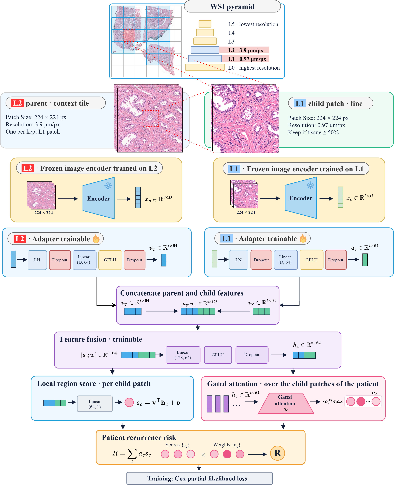

# TRACE: The Price of Faithful Explanations in Multiple Instance Learning for Prostate Cancer Recurrence

We predict biochemical recurrence (BCR) after prostatectomy from one H&E slide per patient with an
**additive multi-scale MIL model**, and we measure, and train for, the **faithfulness of its explanations**.

- Each 0.22 mm patch (L1) is read together with the surrounding tissue at a lower magnification (L2, optionally L3).
- Every magnification has its own DINO encoder, trained from scratch on that level.
- The patient risk is a sum of patch terms, so Shapley attributions add up exactly to the risk and region contributions are
  sums of patch contributions.
- Faithfulness is tested by deletion and insertion at equal tissue area, and can be trained with extra loss terms.
- A per-patient report separates what the model measured from what is inferred, and abstains when evidence is weak.

Data: RUMC (508 patients) and TCGA-PRAD (298 patients), 10-fold cross-validation, C-index within each cohort.

The **Framework**:



## Install

```bash
pip install -r requirements.txt
```

A GPU is needed for DINO pre-training and recommended for feature extraction. H-optimus-0 (Table 1 baseline) is gated on
the Hugging Face hub: accept its licence and log in first.

## Data

Put in one folder, the **data root** (`--root`, or the environment variable `TRACE_DATA_ROOT`, default: current directory):

- `images/<case>.tif`: pyramidal slides of both cohorts (level k has 4^k times the pixel size of level 0)
- `tissue-masks/<case>_tissue.tif`: tissue masks
- label CSVs with `case_id, event, follow_up_years`

RUMC comes from the LEOPARD challenge release, TCGA-PRAD from the TCGA data portal with the BCR labels of Grisi et al.
(see the paper). Then:

```bash
python scripts/00_prepare_data.py --labels labels_rumc.csv labels_tcga.csv
```

This creates the table of cases and the folds of the paper (`data/folds.csv`). Everything else is written inside the data root.

## Run

`scripts/reproduce_paper.sh` runs all the steps below in order. Each step can also be run alone, and finished work is skipped.

| Step | Script | What it does |
|---|---|---|
| 1 | `01_build_anchors.py` | selects the tissue tiles (L2 tiles and their 16 L1 sub-tiles; grids for levels 0 and 3) |
| 2 | `02_extract_tiles.py` | cuts the raw tiles of one level for pre-training |
| 3 | `03_train_dino.py` | trains the DINO encoder of one level |
| 4 | `04_extract_features.py` | encodes the tiles once (DINO, Prost40M, H-optimus-0, QuiltNet) |
| 5 | `05_train.py` | trains and evaluates a model with cross-validation |
| 6 | `06_faithfulness.py` | deletion and insertion tests of a trained model |
| 7 | `07_ontology_concepts.py` | links the report concepts to NCI Thesaurus and UBERON terms |
| 8 | `08_explain.py` | Shapley values of every patient and the cohort patterns |
| 9 | `09_make_reports.py` | PDF report and figures of a patient |
| 10 | `10_tables.py` | Tables 1 to 3 of the paper |

## Models

A model is defined by which tiles are its instances (`--views`); their features are concatenated.

| Model | Command |
|---|---|
| single level L1, L2, L3, L0 | `--views children`, `parents`, `grid3`, `grid0 --pool 8192` |
| L1 + L2 context | `--views children ctx2` |
| L1 + L2 + L3 context | `--views children ctx2 ctx3` |
| faithfulness-aware training | add `--suff-cox 0.5 --nec-var 0.5 --ent 0.3 --topk 0.1` (and `--faith-start-epoch 10` for the warm-up) |

```bash
python scripts/05_train.py --run-name ctx3_dino --views children ctx2 ctx3 --save-models
python scripts/06_faithfulness.py --run ctx3_dino
```

`--save-models` is needed for the faithfulness tests and the report. Results are in `runs/<run>/` (predictions and C-index per
fold) and `faithfulness/<run>/`.

## Report

```bash
python scripts/07_ontology_concepts.py --ncit Thesaurus.FLAT.zip --uberon uberon-basic.obo
python scripts/08_explain.py --run ctx3_dino
python scripts/09_make_reports.py --run ctx3_dino --cases <case_id> --figures
```

The report has three levels: the signed contribution of each region (what the model measured), the cohort pattern of its
patches, and an automatic concept match that is shown only when the concept has cohort-level evidence. The patterns are
named automatically in `report/patterns.json`, which you can edit.

## Layout

```
trace_mil/   the library        scripts/   the steps above        configs/   runs behind each table row        data/   folds of the paper
```
